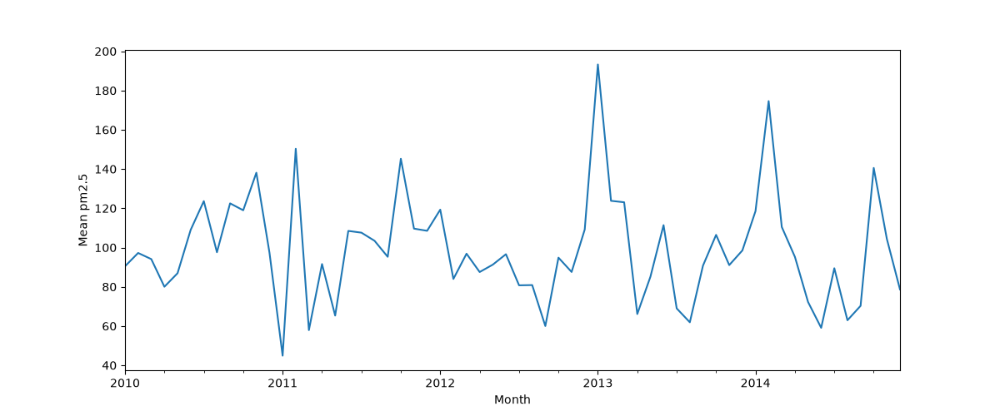

# Predicting Beijing Air Quality Using Machine Learning



## Dataset + Credit

This project uses the [UC Irvine Machine Learning Repository](https://archive.ics.uci.edu/)'s [Beijing PM2.5](https://archive.ics.uci.edu/dataset/381/beijing+pm2+5+data) dataset, which contains PM2.5 data from the US Embassy in Beijing.

## Question/Problem

When do Random Forest models predict pollution better than baseline/naive models?

**TL;DR Answer:** Random Forest models clearly outperform the baseline when predicting current pollution given weather features, but at best only marginally so when predicting future pollution.

## EDA

Some important findings from exploratory data analysis:

- Northwesterly wind had a median `pm2.5` around a third of southeasterly wind or calm conditions (likely due to less industrialization north of Beijing).

- `Iws` (cumulative wind speed) was confirmed to be a running total of wind speed that resets whenever the wind direction changes. The hourly wind speed inferred from this variable ended up being a strong feature.

- Out of 43,824 rows, there were 2,067 missing values (all in the target variable, `pm2.5`). Most of these came from 2010-2012. Short gaps in the data were addressed by interpolation, while long gaps of multiple days were omitted from training and testing for models.

- The distribution of raw `pm2.5` was heavily right-skewed, so I elected to target a log(1 + x) transformation of `pm2.5` for the models, which was much more symmetric.

- The correlation tables showed that there were not any strong simple linear relationships between the feature variables and the log-transformed `pm2.5`, which suggested that a more rigid/linear-based model might not perform well.

## Approach

First, the model was trained to predict current pollution given current-hour features. Next, lag features were added so the model could use previous timestamps' pollution numbers to make predictions - 1-hour-ago and 24-hours-ago features were inserted. Finally, I forecast ahead: one model predicted the change in pollution over the next hour, and another predicted the pollution level 24 hours out.

## Train/Test Split and Model Selection

The train/test split was approximately 80/20, and it was done by year. This is because with time series data, adjacent observations are closely related, and a random split would put adjacent hours in both the training and test set. This would make the models "memorize" particular pollution numbers in the training set and spit them out for neighboring rows in the test set. This is data leakage. Specifically, I used years 2010-2013 for training and 2014 for testing.

The weak linear correlations suggested a linear model would struggle, and it did (R-squared score of only about 0.37), so I tried a Random Forest, which can capture nonlinear effects and interactions. As explained later (see below), Random Forest ended up performing better in one of three tasks.

## Summary of Results

Below, the units for the model performance are RMSE (Root Mean Squared Error) in log(1 + PM2.5) units, where a lower score indicates a better performance.

| Task | Baseline | Best model | Verdict |
| - | - | - | - |
| Estimate the *current* hour from current weather | 1.035 (mean) | 0.68 (Random Forest (RF)) | clear win |
| Forecast 1 hour ahead | 0.270 (persistence baseline) | 0.252 (RF, predicting change) | roughly a tie |
| Forecast 24 hours ahead | 1.036 (mean baseline) | 0.994 (RF) | marginal |

## Takeaway (Answer to Question)

The answer to the research question is that Random Forest models perform much better than the baseline when it comes to predicting current pollution given weather data. When it comes to forecasting pollution, however, the models struggled to outperform a baseline approach (for example, simply using the current hour to predict the next), which is expected since in this case, the model cannot know future weather.

## Limitations

1. For the 24-hour task, the target variable is pollution level in 24 hours. This means that the targets for the last day of 2013 (which is the last day of the training set) are actually from the next year (January 1 2014), meaning there is some overlap. At only 24 rows out of about 33,000, this is not a big deal.

2. For small gaps (6 hours or less) in the data, interpolated values were used. This means that the model gets to "see" a little bit in the future and cheat slightly for the forecasting models. That said, this only happens for 250 filled-in hours.

3. While there is a lot of hourly data, the test set only spans 1 year. Therefore, small changes in RMSE (e.g., from 0.270 to 0.252) may shift around for a different year.

4. Only observed weather was used; no forecasted weather.

5. The forests did not get tuned; this would be a natural possible next step.

## Next Steps

The most intriguing next step would be including weather forecast data. Additionally, editing the methods of the project to include boosting, tuning, or cross-validation over multiple years could address the issue in limitation 3.

## How to Run the Notebooks

These steps use a terminal opened in the project's root folder (the one containing `README.md` and `requirements.txt`). In VS Code, open that folder and use Terminal → New Terminal.

1. **Check the data.** Make sure the dataset is at `data/PRSA_data.csv`. The notebooks read it from `../data/PRSA_data.csv`.

2. **Create a virtual environment:**

   ```powershell
   python -m venv .venv
   ```

3. **Activate it:**

   - Windows (PowerShell): `.venv\Scripts\Activate.ps1`
   - macOS/Linux: `source .venv/bin/activate`

4. **Install the dependencies:**

   ```powershell
   pip install -r requirements.txt
   ```

5. **Open the notebooks** in the `notebooks/` folder and select the `.venv` Python as the kernel (in VS Code: the kernel picker at the top right of the notebook). Run `01_eda.ipynb` first, then `02_modeling.ipynb`.

***Note:*** The notebooks read `../data/PRSA_data.csv`, so make sure they are run from inside the `notebooks` folder.

# Thank You for Reading!

Take a look at the notebooks ([EDA](/notebooks/01_eda.ipynb), [Modeling](/notebooks/02_modeling.ipynb)), and thanks for checking this out! Let me know your thoughts by shooting me a message on [LinkedIn](https://www.linkedin.com/in/hoswaymolina/)!